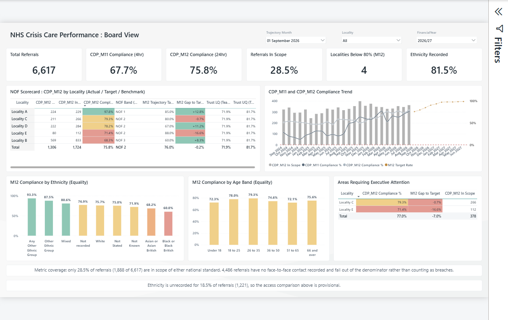
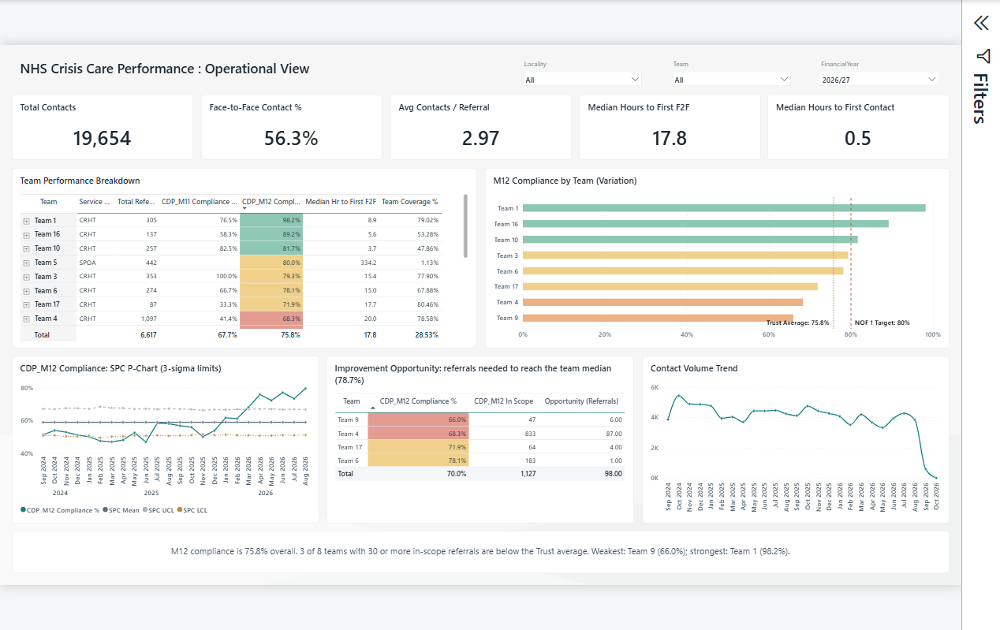
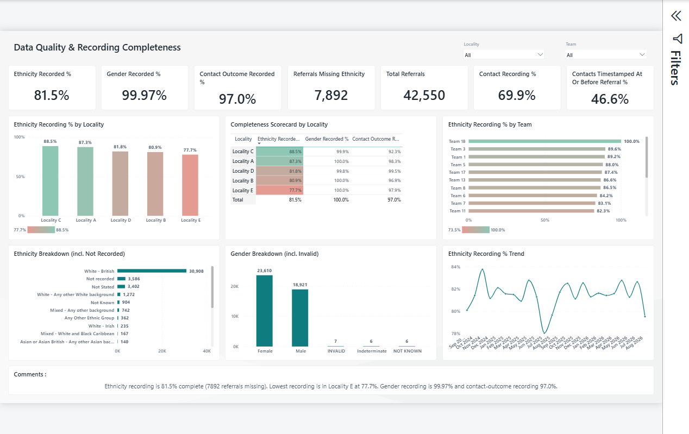

# NHS Crisis Care Performance Dashboard

A Power BI dashboard for adult crisis mental-health services, built for a Performance Improvement Manager assessment. It tracks the two national crisis-response standards from the NHS Community Data Pack:

- **CDP_M11**: people referred as *very urgent* get a face-to-face contact within **4 hours**.
- **CDP_M12**: people referred as *urgent* get a face-to-face contact within **24 hours**.

The dashboard reports compliance by locality, team, ethnicity and age band. It benchmarks each locality against NHS Oversight Framework (NOF) bands and a monthly trajectory, uses SPC to separate real change from noise, and has a data-quality page that shows how far the figures can be trusted.

It is built as a Power BI Project (**PBIP**). The semantic model is stored as TMDL and the report as PBIR, so every measure and visual is a readable text file you can diff and version-control.

---

## Pages

### 1. Board View

The executive summary. A KPI strip shows total referrals, M11 and M12 compliance, metric coverage, the number of localities below 80% on M12, and the ethnicity recording rate. The **NOF scorecard** lists each locality's M12 actual, NOF band, next trajectory target, gap to target, and the Trust lower and upper quartiles, with RAG colouring. A combined trend chart shows M11 and M12 compliance and in-scope volume, with the trajectory projected forward. Two equality charts break M12 compliance down by ethnicity and age band, and an **Areas Requiring Executive Attention** table picks out localities below target. Commentary cards explain coverage and data-quality caveats in plain English. Slicers: Trajectory Month, Locality, Financial Year.

### 2. Operational View

For service and team managers. KPIs cover total contacts, face-to-face contact %, contacts per referral, and median hours to first face-to-face and first contact. The **Team Performance Breakdown** matrix (team → referral source) shows service model, volumes, M11/M12 compliance, median time to face-to-face and team coverage. Other visuals:

- M12 compliance by team, against the Trust average and the NOF 1 target of 80%.
- An **SPC p-chart** of monthly M12 compliance with 3-sigma control limits.
- An **improvement-opportunity** table showing how many extra compliant referrals each below-median team would need to reach the team median.
- A contact-volume trend.

Slicers: Locality, Team, Financial Year.

### 3. Data Quality & Recording Completeness

Recording rates for ethnicity, gender and contact outcome. It also shows the share of referrals that have a contact recorded, and the share of contacts timestamped at or before the referral (a data-entry red flag). Ethnicity recording is broken down by locality, team and month, alongside a completeness scorecard by locality. Ethnicity and gender breakdowns keep the *Not recorded*, *Not stated* and *Invalid* categories visible rather than hiding them.

### 4. Referral Detail (Drillthrough)
A hidden drillthrough page. Right-click a team or locality on any page to see the referral-level rows behind the figures. No screenshot is included because the page shows record-level data.

---

## Semantic model

Star schema with three fact tables and five dimensions:

| Table | Grain / purpose |
|---|---|
| `Fact_Referral` | One row per referral: urgency, team, locality, demographics, M11/M12 compliance status, hours to first contact and first face-to-face |
| `Fact_Contact` | One row per contact: date, type, medium, outcome |
| `Fact_Trajectory` | Monthly M12 target rate per locality |
| `Dim_Date` | Calendar with financial year |
| `Dim_Team`, `Dim_Locality`, `Dim_ReferralSource`, `Dim_Ethnicity` | Conformed dimensions shared by the fact tables |

Power Query is organised into staging (`Stg_Crisis`) and transform (`Entity_Crisis`) queries. They replace literal `"NULL"` strings with real nulls and fix data types before the fact and dimension tables are built.

### Key modelling decisions
- **Compliance is passed ÷ in scope, counted by distinct referral.** A referral is in scope only when its status is `Pass` or `Breach`. Referrals without a face-to-face contact fall out of the denominator rather than counting as breaches, so the dashboard reports **Metric Coverage %** next to every compliance figure.
- **NOF bands** follow the oversight thresholds for M12: ≥80% NOF 1, ≥71% NOF 2, ≥63% NOF 3, otherwise NOF 4. The same thresholds drive the RAG colour measures.
- **SPC limits** use a p-chart: mean ± 3σ, clipped to the range 0–100%.
- **Opportunity sizing** only counts teams with at least 30 in-scope referrals, so very small teams don't skew the figures.

### Measures
About 60 measures, grouped into display folders: KPIs, CDP_M11, CDP_M12, timeliness, equality, NOF benchmark, SPC, coverage, opportunity, data quality, and dynamic **commentary** measures that write the narrative text on each page.

---

## Running it

1. Install a recent version of [Power BI Desktop](https://powerbi.microsoft.com/desktop/) (PBIR report format support is required).
2. Clone the repo and open `Performance Improvement Manager Analysis.pbip`.
3. The source dataset is **not included**. The `Crisis Dataset` query reads an Excel workbook from a local path. Edit that query, or *Transform data → Data source settings*, to point at your own copy, then refresh.

## Repository contents

| Path | What it is |
|---|---|
| `Performance Improvement Manager Analysis.pbip` | Project file; open this in Power BI Desktop |
| `*.Report/` | Report definition (PBIR): pages, visuals, theme |
| `*.SemanticModel/` | Semantic model (TMDL): tables, measures, relationships, Power Query |
| `NHS Crisis Care - Briefing Note.docx` | Briefing note summarising the findings |
| `NHS Crisis Care - Technical Walkthrough.docx` | Walkthrough of the model and how the measures work |
| `Team Performance Breakdown.csv` | Team-level summary export |
| `images/` | Page screenshots used in this README |
